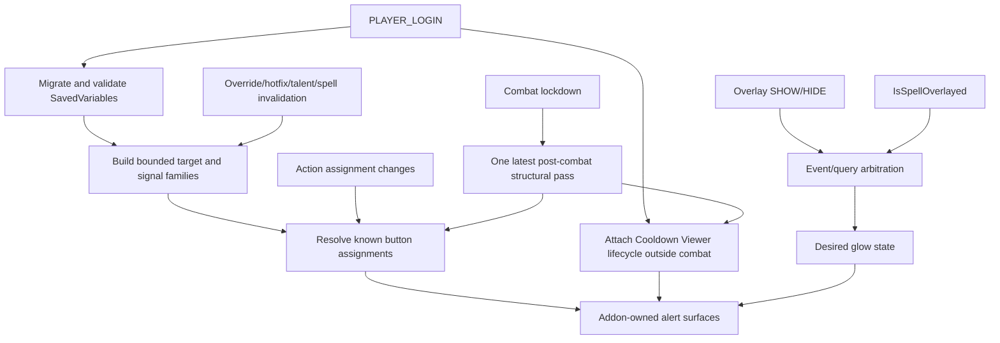

# Architecture

Release `1.4.3` targets Retail 12.1.5 with expected interface `120105`. Current live source `12.1.5.70783` was checked on 2026-11-04; the relevant ActionBar, Spell Activation Overlay, alert-template, Settings, and Cooldown Viewer contracts remain compatible with the selected KB baseline. Named-client behavior remains **NOT-RUN**.

## Runtime flow

## Ownership model

Every file receives the same second TOC vararg table. `Core.lua`, `Debug.lua`, and `Options.lua` compose through that table; implementation state stays file-local. The only intentional globals are the SavedVariables root, slash-command registration, and the named debug frame required by `UISpecialFrames`.

## Detection

The Spell Activation Overlay event/query pair is the sole proc authority. SHOW/HIDE events are synchronous wake-ups. The official query supplies current state when caller, argument, and result are accessible. A short SHOW grace covers same-frame ordering; inaccessible/unavailable query state has one bounded fallback lifetime.

Action-bar events update assignment ownership only. Mapping invalidations coalesce outside combat and refresh already observed assignments immediately in combat without creating structure. Duplicate or irrelevant Cooldown Viewer override events do no work.

## Spell identity and bounds

`targetSpellIDs` and `signalSpellIDs` are validated ordinary integer arrays, capped at 32 entries each. `targetFamily` expands configured roots through `C_Spell.GetBaseSpell`, `C_Spell.GetOverrideSpell`, and explicit Cooldown Viewer override pairs. `signalFamily` adds configured overlay aliases. An alias does not become an action-button target merely because it produced an event.

## Action buttons

Known stock and supported third-party button surfaces are weakly tracked. The current action slot is resolved from the button's authoritative provider; `C_ActionBar.GetSpell` is primary, with a resolved action/macro fallback only when ordinary and available.

One-slot changes get a targeted refresh. Bursty/broad invalidations collapse into one complete pass. There is no 540-slot sweep, macro-body parsing, per-frame polling, or action-event proc query.

## Cooldown Viewer

The adapter uses public data/override/hotfix events as wake-ups and source-verified private instance methods as a narrow compatibility boundary. Viewer pools are enumerated only during setup/recovery outside combat. Actual viewer/item instances are post-hooked once. Item identity uses `GetBaseSpellID`; linked managed aura state is never inspected.

A complete readable generation covering all four selected viewers may prune unseen items. Missing, inaccessible, or unreadable viewers/pools are incomplete evidence and cannot authorize pruning. During combat, only observed items and existing alerts are reused.

## Rendering

Frame state is held in weak-key addon tables. The addon creates its own `ActionButtonSpellAlertTemplate` child and never joins or patches `ActionButtonSpellAlertManager`.

Show/hide is idempotent. Visibility, animation, and geometry readiness are tracked separately. Structural geometry failures remain dirty and retry on an authoritative lifecycle pass; inaccessible OFF transitions become owned pending hides. No polling is used.

## Settings and persistence

`SuddenDoomGlowDB` owns `enabled`, `cdm`, `debug`, `glowScale`, bounded target/signal lists, schema, and producer version. Migration runs once before Settings registration. Blizzard's Settings UI writes ordinary fields through `RegisterAddOnSetting`; addon callbacks apply idempotent runtime effects.

Future schemas are preserved unchanged and disable all mutation. Frames, timers, callback owners, hooks, event signals, resolved families, and observed override relationships remain runtime-only.

## Code map

| Area | Owner |
|---|---|
| Runtime, persistence, rendering, integrations | `Core.lua` |
| Blizzard Settings | `Options.lua` |
| Diagnostics | `Debug.lua` |
| Source contracts | `docs/API_CONTRACTS.md` |
| Broad/focused host regressions | `tests/runtime_smoke.lua`, `tests/runtime_regression.lua` |
| Deterministic package | `scripts/package.py` |
