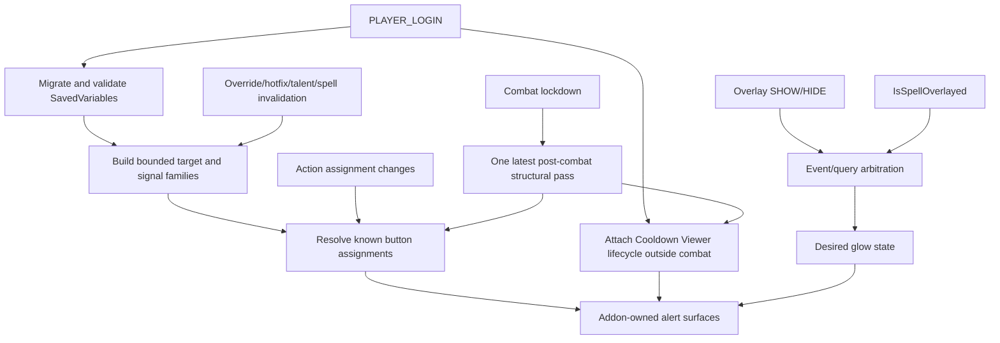

# Architecture

Release `1.4.7` targets Retail 12.1.5 with expected interface `120105`. Current live source `12.1.5.70783` was checked on 2026-11-04; the relevant ActionBar, Spell Activation Overlay, alert-template, Settings, and Cooldown Viewer contracts remain compatible with knowledge-base revision `c2a630aa186de401262663cc8568a77988be69df` and its selected UI-source baseline. Named-client behavior remains **NOT-RUN**.

## Runtime flow

## Ownership model

Every file receives the same second TOC vararg table. `Core.lua`, `Debug.lua`, and `Options.lua` compose through that table; implementation state stays file-local. The only intentional globals are the SavedVariables root, slash-command registration, and the named debug frame required by `UISpecialFrames`.

## Detection

The Spell Activation Overlay event/query pair is the sole proc authority. SHOW/HIDE events are synchronous wake-ups. The official query supplies current state when caller, argument, and result are accessible. A relevant SHOW payload or the last positive candidate is queried first, but authoritative OFF still requires every candidate to be readable and false. A decisive immediate read suppresses the duplicate delayed read. Opaque payloads may wake bounded candidate reconciliation without being compared, indexed, stored, or treated as identity. A short SHOW grace covers same-frame ordering; inaccessible/unavailable query state has one bounded fallback lifetime. Every delayed evidence owner has a terminal path: timer failure falls back to identity-gated `After`, bounded synchronous reconciliation, or conservative evidence clearing rather than retaining an unexpiring ON state.

Action-bar events update assignment ownership only. Mapping invalidations coalesce outside combat and refresh already observed assignments immediately in combat without creating structure. Duplicate or irrelevant Cooldown Viewer override events do no work.

## Spell identity and bounds

`targetSpellIDs` and `signalSpellIDs` are validated ordinary integer arrays, capped at 32 entries each. Resolved target and signal families are independently capped at 128 IDs so replacement learning cannot turn overlay reconciliation into unbounded work. Configured signal aliases reserve their budget before learned target variants. `targetFamily` expands configured roots through `C_Spell.GetBaseSpell`, `C_Spell.GetOverrideSpell`, and explicit Cooldown Viewer override pairs. An alias does not become an action-button target merely because it produced an event.

## Action buttons

Known stock and supported third-party button surfaces are weakly tracked. The current action slot is resolved from the button's authoritative provider; `C_ActionBar.GetSpell` is primary, with a resolved action/macro fallback only when ordinary and available. Every foreign field/method read is access-gated and isolated from hostile/inaccessible metatables before it can influence assignment state. Object-policy methods must yield ordinary booleans, and a conditionally constrained object without an affirmative current-context result is unavailable. Named adapters cover current `BT4ButtonN`, `ElvUI_BarXButtonY`, `DominosActionButtonN`, and Dominos `MultiBar*ActionButtonN` families only after the exact second `C_AddOns.IsAddOnLoaded` result confirms completion; loading-in-progress is not readiness; the exact donor pins and limits are recorded in `docs/DONOR_REVIEW.md`.

Known buttons maintain one weak reverse index from current action slot to button. A positive `ACTIONBAR_SLOT_CHANGED(slot)` performs an immediate targeted refresh and one coalesced targeted next-frame retry; only the exact zero payload is broad, and denied/malformed payloads do nothing. Each assignment pass queries one slot once and shares the result across its current button owners. If a settled structural rescan is pending, it cancels and replaces queued complete assignment work. World/spec/secrecy recovery likewise has one owner and immediately revokes old button-slot/CDM assignment authority before the settled pass. There is no 540-slot sweep, macro-body parsing, per-frame polling, or action-event proc query.

## Cooldown Viewer

The adapter uses public data/override/hotfix events as wake-ups and source-verified private instance methods as a narrow compatibility boundary. Provider-loaded state and current viewer access are established before instance-member discovery. Viewer/pool/item reads are fail-closed and protected from throwing metatables. Viewer pools are enumerated only during setup/recovery outside combat. Actual viewer/item instances are post-hooked once; every selected item lifecycle method and the viewer acquire hook must be installed before assignment authority is restored. Missing or failed hooks are incomplete evidence, remain hidden, and retry only on a later lifecycle pass. Item identity uses `GetBaseSpellID`; linked managed aura state is never inspected.

A complete readable generation covering all four selected viewers may prune unseen items. Missing, inaccessible, or unreadable viewers/pools are incomplete evidence and cannot authorize pruning. During combat, only observed items and existing alerts are reused.

## Rendering

Frame state is held in weak-key addon tables. The addon creates its own `ActionButtonSpellAlertTemplate` child and never joins or patches `ActionButtonSpellAlertManager`.

Show/hide is idempotent. Visibility, animation, and geometry readiness are tracked separately. Already-active alerts revalidate the alert and both animation destinations at explicit lifecycle wakes. Every render target receives at most one size-change hook, but only the currently owned target may invalidate geometry. A runtime generation token invalidates all cached geometry after global scale changes, including surfaces that were inaccessible at the time. Failed access, member lookup, hook, frame-level read/write, anchor, parent, or size operations remain dirty and retry on an authoritative lifecycle pass. An assigned but inaccessible icon target never authorizes a fallback reparent to the button. A successful current-target size callback completes synchronously without leaving global recovery dirty. Stable rescans reuse completed geometry without repeating mutations; inaccessible OFF transitions become owned pending hides. No polling is used.

## Settings and persistence

`SuddenDoomGlowDB` owns `enabled`, `cdm`, `debug`, `glowScale`, bounded target/signal lists, schema, and producer version. Migration runs once before Settings registration. Blizzard's Settings UI writes ordinary fields through `RegisterAddOnSetting`; addon callbacks apply idempotent runtime effects.

Future schemas are preserved unchanged and disable all mutation. Frames, timers, callback owners, hooks, event signals, resolved families, and observed override relationships remain runtime-only. Diagnostic output also treats the chat frame and refresh callback object as foreign/current-lifecycle destinations.

## Code map

| Area | Owner |
|---|---|
| Runtime, persistence, rendering, integrations | `Core.lua` |
| Blizzard Settings | `Options.lua` |
| Diagnostics | `Debug.lua` |
| Source contracts | `docs/API_CONTRACTS.md` |
| External implementation evidence | `docs/DONOR_REVIEW.md` |
| Broad/focused host regressions | `tests/runtime_smoke.lua`, `tests/runtime_regression.lua` |
| Deterministic package | `scripts/package.py` |
