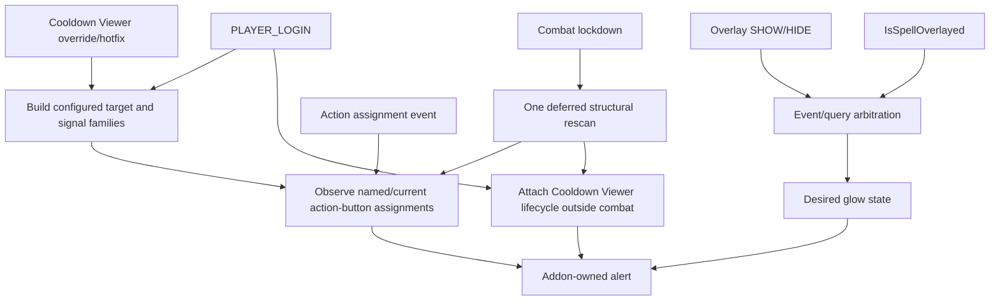

# Architecture

Release `1.4.2` targets Retail 12.1.5, expected interface `120105`. The KB-selected source is `12.1.5.70688`; current live source `12.1.5.70783` was checked on 2026-11-03 and contains no changes in the source slices used here. Client behavior remains **NOT-RUN**.

## Runtime flow

## Detection

The Spell Activation Overlay event/query pair is the sole proc authority. Synchronous SHOW/HIDE events wake reconciliation. The official query supplies current state when its caller, argument, and result are accessible. A short SHOW grace covers unresolved same-frame ordering; unavailable query state has one bounded fallback lifetime.

Action-bar and addon-load events update assignment ownership. Cooldown Viewer hotfix plus talent/spell invalidations drop stale override observations and rebuild mappings without forcing an OFF/ON transition. Irrelevant override events are ignored.

## Spell identity

`targetRoots` comes from SavedVariables. `targetFamily` expands roots using `C_Spell.GetBaseSpell`, `C_Spell.GetOverrideSpell`, and explicit `COOLDOWN_VIEWER_SPELL_OVERRIDE_UPDATED` pairs. `signalFamily` contains target-family IDs plus explicitly configured overlay aliases. An alias does not become an action-button target merely because it produced an event.

## Action buttons

The addon observes stock buttons and supported named third-party surfaces. The current action slot is resolved from the button's authoritative provider. `C_ActionBar.GetSpell` is primary; an ordinary no-spell result may fall back to `GetActionInfo` and resolved `GetMacroSpell`.

A positive slot event receives one immediate targeted update. Bursty or broad invalidations collapse into one next-frame full pass over known buttons. No slot sweep, macro-body search, per-frame polling, or action-event proc query is used.

## Cooldown Viewer

The adapter uses the public data-ready event as a recovery wake-up and observes the four selected viewer instances and their active item pools only at setup/recovery boundaries. Actual viewer/item instances are post-hooked once outside combat. Item identity uses `GetBaseSpellID`; `GetSpellID` is deliberately excluded because managed aura/linked-spell precedence can change its meaning.

A reset/reassignment callback can clear one item. A complete readable observation of all selected viewer pools may prune unseen items. A missing, inaccessible, or unreadable viewer/pool table makes the generation incomplete and therefore cannot authorize pruning.

During combat, only already observed item instances and existing alerts are refreshed. New hooks, pool enumeration, parenting, sizing, anchoring, and alert construction wait for one post-combat rescan.

## Rendering

Frame metadata lives in weak-key addon tables. The addon creates a child from `ActionButtonSpellAlertTemplate` but does not call or mutate `ActionButtonSpellAlertManager`.

Show/hide is idempotent. Animation start is tracked separately from frame visibility: if an animation object is temporarily inaccessible, the visible alert remains owned and a later authoritative lifecycle refresh retries the animation without requiring a second proc edge. Inaccessible OFF transitions become owned pending hides and are recovered without polling.

## Persistence

`SuddenDoomGlowDB` stores ordinary user settings and `schemaVersion`. Migrations preserve unrelated data and intentional empty spell lists. Future schemas are preserved unchanged, disable runtime mutation, and produce explicit command errors. Frames, timers, hooks, event signals, resolved families, and override observations remain runtime-only.

## Code map

| Area | Owner |
|---|---|
| SavedVariables, spell families, overlay arbitration, action mapping | `Core.lua` |
| Alert ownership and lifecycle | `Core.lua` |
| Cooldown Viewer adapter | `Core.lua` |
| Blizzard Settings UI | `Options.lua` |
| Bounded diagnostics | `Debug.lua` |
| Source evidence | `docs/API_CONTRACTS.md` |
| Broad and focused stub regressions | `tests/runtime_smoke.lua`, `tests/runtime_regression_1_4_2.lua` |
| Deterministic release archive | `scripts/package.py` |
