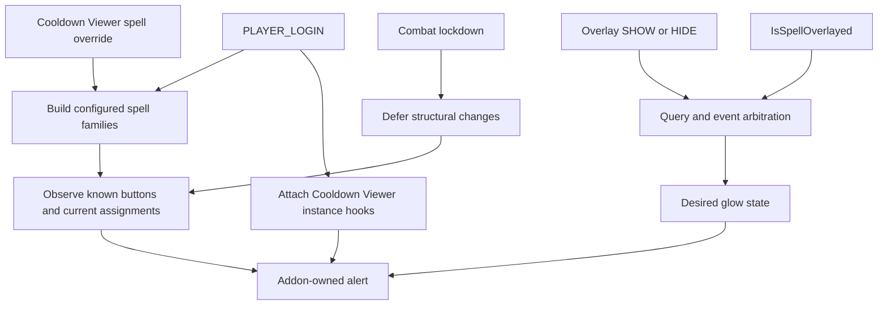

# Architecture

Release `1.4.1` targets Retail 12.1.5 with expected TOC interface `120105`. Source was checked on 2026-11-03 at `12.1.5.70688` / `d07eb00237d8891f153215db98a5df880a26cfe5`; current `live` head matches this pin. Static checks, Lua 5.1.1 syntax, and stubbed runtime smoke pass; live client behavior is **NOT-RUN**. See [API contracts](docs/API_CONTRACTS.md).

## Runtime flow

## Detection

Positive overlay-query evidence is scoped to configured spell IDs. A family/configuration change triggers immediate revalidation of known button and Cooldown Viewer assignments; structural work remains deferred in combat. Owned pending hides are recovered on authoritative context events, including while the addon is disabled, without polling.

Unreadable overlay event payloads still wake an authoritative query, and a missed ON transition is recovered on an authoritative context event. The detection authority is the Spell Activation Overlay event/query pair. `SPELL_ACTIVATION_OVERLAY_GLOW_SHOW` and `...GLOW_HIDE` wake reconciliation; `C_SpellActivationOverlay.IsSpellOverlayed` supplies current state when its caller and inputs are allowed. The addon keeps each event spell independent, treats incomplete query evidence as unknown, and uses a bounded fallback when the query is unavailable.

`targetRoots` comes from defaults and SavedVariables. `targetFamily` expands configured roots with base and override relationships and explicit Cooldown Viewer override events. `signalFamily` includes configured overlay aliases used for detection. A signal alias does not by itself become an action-button target.

## Action buttons

The addon discovers buttons through known named surfaces and observed current assignments. It reads the spell in a button's current slot with `C_ActionBar.GetSpell`; an ordinary result without a spell ID can fall back to `GetActionInfo` and `GetMacroSpell`. Failed or inaccessible queries remain unknown. A button is rendered only after its current readable assignment belongs to the configured target family. One weak `trackedButtons` set owns current matches and one weak `knownButtons` set owns observed surfaces. A relevant slot event updates that slot immediately; a single coalesced next-frame pass then rechecks all known buttons to cover provider update ordering. Deep frame enumeration is manual.

Pageable bars prepare alerts outside combat; static Blizzard multibars allocate them only for matching spells.

## Cooldown Viewer

When enabled, the addon observes the actual four configured viewer instances, reconciles their active item pools at setup/recovery boundaries, and hooks each observed item instance's assignment/reset methods. Item identity is evaluated through `GetBaseSpellID`; `GetSpellID` can select managed aura identity and is not used for this match. Overlay events update the already tracked item set; they do not trigger pool enumeration.

These viewer member names and frame pools are source-coupled implementation details. See [API contracts](docs/API_CONTRACTS.md) for exact pins and the extension boundary.

## Rendering and ownership

Weak-key tables hold addon metadata; external frames do not receive addon fields. The addon creates an alert child using Blizzard's `ActionButtonSpellAlertTemplate`, then controls its animation and visibility. This template and its named animation children are private UI implementation details, not a public extension contract.

Alert creation, parenting, sizing, and anchoring happen outside combat. In combat, existing addon-owned presentation is shown or hidden only. A stale or unreadable assignment cannot authorize a new button glow.

## Persistent data

`SuddenDoomGlowDB` stores user settings and `schemaVersion`. Future schemas remain untouched and inactive; slash commands report that mutation is unavailable instead of echoing values from the scratch runtime defaults. Frame maps, event signals, timers, explicit current-session overrides, and resolved spell families remain runtime-only.

## Code map

| Area | Main code |
|---|---|
| SavedVariables migration and options | `InitializeDB`, `GetOption`, `SetOption` in `Core.lua` |
| Secret/access boundary | `IsAccessible`, `SafeNumber`, `FrameCanBeUsed` in `Core.lua` |
| Spell family and override handling | `RebuildSpellFamilies`, `IsTargetFamilySpell`, `LearnExplicitOverride` in `Core.lua` |
| Action assignment and button mapping | `GetActionSpellID`, `GetButtonSlot`, `MapNamedButtons`, `RefreshKnownButtons` in `Core.lua` |
| Glow ownership | `GetFrameState`, `EnsureAlert`, `ShowFrameGlow`, `HideFrameGlow` in `Core.lua` |
| Cooldown Viewer | `CDMFrameMatches`, `ReconcileCDMFrames`, `HookCDMItem` in `Core.lua` |
| Signal arbitration | `QueryOverlayState`, `SetEventSignal`, `ReconcileGlow` in `Core.lua` |
| Settings UI | `Options.lua` |
| Diagnostics window and logging | `Debug.lua` |

The static checker and smoke harness are described in [tests/README.md](tests/README.md). The historical [1.3.1 release note](docs/RELEASE_1.3.1.md) remains historical.
