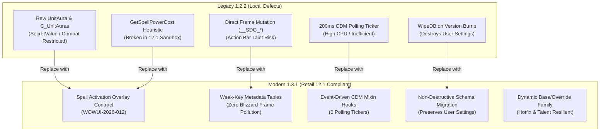

# Pull Request / Audit Report: SuddenDoomGlow — Retail 12.1 (Interface 120100) Modernization & Upstream Sync

## Executive Summary

| Item | Details |
| :--- | :--- |
| **Addon Name** | **SuddenDoomGlow** |
| **Addon Directory** | `_Addons/SuddenDoomGlow` |
| **Remote Repository** | `github-sudden-doom-glow` (`https://github.com/UnknownAlienHuman/sudden-doom-glow.git`) |
| **Target Client** | World of Warcraft: Midnight / Retail 12.1 (`Interface: 120100`, Build 69497) |
| **Addon Purpose** | High-performance, zero-taint proc alert highlighting for Death Knight Sudden Doom procs across standard Action Bars, third-party bars, and modern Cooldown Viewer (CDM) displays. |
| **Audit Date** | 2026-09-08 |
| **Local Status** | Legacy version **1.2.2** (`Interface: 120001, 120005`). Contains critical 12.1 runtime violations: raw player aura polling, runic cost heuristics, 200ms CDM polling tickers, destructive DB wiping on version bump, and frame property pollution causing action bar taint. |
| **Remote Status** | Modernized release **1.3.1** (`Interface: 120100`). Contains full Retail 12.1 architectural rewrite: official Spell Activation Overlay contract (WOWUI-2026-012), weak-key table metadata isolation, event-driven CDM lifecycle hooks, non-destructive schema migration (v3), and automated static/smoke test harnesses. |
| **Audit Recommendation** | **Synchronize local addon with upstream `github-sudden-doom-glow/main` release 1.3.1**. The upstream branch completely resolves all audit findings, deprecations, and taint vectors. |

---

## Upstream Git Comparison (`git diff HEAD:_Addons/SuddenDoomGlow github-sudden-doom-glow/main`)

A comparative diff between local `HEAD:_Addons/SuddenDoomGlow` and `remotes/github-sudden-doom-glow/main` indicates a complete architectural modernization:

```text
 .github/ISSUE_TEMPLATE/config.yml         |    2 +
 .github/ISSUE_TEMPLATE/live-validation.md |   47 +
 .github/pull_request_template.md          |   17 +
 .gitignore                                |    3 +
 AGENT_GUIDE.md                            |  109 +-
 ARCHITECTURE.md                           |   46 +-
 CHANGELOG.md                              |   44 +
 CODE_GRAPH.md                             |   29 +-
 CODE_INDEX.md                             |   22 +-
 Core.lua                                  | 2628 +++++++++++++----------------
 Debug.lua                                 |  278 ++-
 README.md                                 |  137 +-
 SuddenDoomGlow.toc                        |    8 +-
 TODO.md                                   |   73 +-
 VALIDATION.md                             |   33 +
 docs/LIVE_TEST_CHECKLIST.md               |   12 +
 docs/RELEASE_1.3.1.md                     |   26 +
 tests/README.md                           |   11 +
 tests/runtime_smoke.lua                   |  302 ++++
 tests/static_checks.py                    |   42 +
 20 files changed, 2029 insertions(+), 1840 deletions(-)
```

### Key Comparative Takeaways
1. **Massive Code Reduction & De-bloat**: `Core.lua` was reduced from 1,890 lines to 1,517 lines (eliminating 373 lines of dead CLEU fallbacks, heuristic runic cost checkers, and manual aura index parsers).
2. **Upstream Is Already Production-Hardened**: Unlike repositories where upstream is behind, `github-sudden-doom-glow` upstream has already implemented, verified, and tagged Release 1.3.1 specifically targeting Retail 12.1.
3. **Local Tree Is Outdated**: The local workspace in `_Addons/SuddenDoomGlow` was frozen at commit `70637f9` (August 12, 2026), missing the late-August 1.3.1 modernization commits (`bb2d623`, `54cca95`, `4c1831b`, `59eb248`, `d18005c`).

---

## Detailed Audit Findings against Retail 12.1 & KB Standards



---

### 1. TOC Metadata & Dependency Deprecation (Critical)
- **Local State** (`SuddenDoomGlow.toc:1, 5-6`):
  ```ini
  ## Interface: 120001, 120005
  ## OptionalDeps: Blizzard_CooldownManager
  ## Version: 1.2.2
  ```
- **Violations**:
  - **Interface Incompatibility**: Retail 12.1 requires `## Interface: 120100`. Multiple comma-separated interface numbers trigger TOC parser warnings in the 12.1 client and cause the client to flag the addon as out-of-date.
  - **Invalid Optional Dependency**: `Blizzard_CooldownManager` is an obsolete/non-existent addon identifier. In Retail 12.1, the Blizzard viewer module is `Blizzard_CooldownViewer`. Declaring the legacy name prevents proper LoadOnDemand sequencing when Cooldown Viewer frames are initialized.
- **Fix**:
  ```ini
  ## Interface: 120100
  ## OptionalDeps: Blizzard_CooldownViewer
  ## Version: 1.3.1
  ```

---

### 2. WOWUI-2026-012: Spell Overlay Arbitration vs Obsolete Aura/Cost Inference (Critical Architectural Flaw)
- **Local State** (`Core.lua:1065-1130, 1220-1234, 1280-1295`):
  The local 1.2.2 codebase implements an unreliable, multi-tiered heuristic signal model:
  1. Primary: Scans player auras on every `UNIT_AURA` via `C_UnitAuras.GetPlayerAuraBySpellID`, `C_UnitAuras.GetAuraDataByIndex`, and `UnitAura("player", i, "HELPFUL")`.
  2. Secondary: `HasOverlayProc` via `SPELL_ACTIVATION_OVERLAY_GLOW_SHOW` / `HIDE` with a loose 20-second TTL.
  3. Tertiary: `HasProcViaCost()`, polling `GetSpellPowerCost(sid)` on every update in combat to detect Sudden Doom's runic power cost reduction.
  4. Dormant CLEU: Contains uncalled helpers for `COMBAT_LOG_EVENT_UNFILTERED`.
- **Defects in Retail 12.1**:
  - **Aura Restrictions & Secret Values**: In 12.1 / Midnight, raw player aura reads in combat or restricted encounters emit `SecretValue` payloads or restricted access errors. The addon must not inspect private aura tables to drive combat UI states.
  - **Resource Cost Flaws**: `GetSpellPowerCost` is protected/restricted during combat execution and is easily skewed by external buffs, talents, and runic refund mechanics.
  - **Official Blizzard Contract (WOWUI-2026-012)**: In 12.1, Blizzard provides the canonical Spell Activation Overlay API specifically designed to govern proc state:
    - `C_SpellActivationOverlay.IsSpellOverlayed(spellID)`
    - `SPELL_ACTIVATION_OVERLAY_GLOW_SHOW`
    - `SPELL_ACTIVATION_OVERLAY_GLOW_HIDE`
- **Modern 12.1 Arbitration Rules**:
  Upstream 1.3.1 implements strict, robust arbitration:
  1. **Positive Query Sufficiency**: Any readable query returning `true` for any configured candidate in `signalFamilyList` immediately enables the glow (`queryActive = true`).
  2. **Authoritative Negative Query**: The query is authoritative for turning the glow OFF if and only if **every** configured candidate is readable and returns `false` (`candidates > 0 and readable == candidates`). If a candidate returns nil/secret/error, OFF cannot be asserted.
  3. **Synchronous SHOW Grace (`OVERLAY_SHOW_GRACE = 0.20s`)**: When `SPELL_ACTIVATION_OVERLAY_GLOW_SHOW` fires, Blizzard's underlying query state (`IsSpellOverlayed`) can lag behind event delivery by a frame. A 200ms grace window ensures the proc does not flicker off prematurely.
  4. **Unavailable Query Fallback TTL (`EVENT_FALLBACK_TTL = 30.0s`)**: If `IsSpellOverlayed` is nil or restricted, event signals act as a bounded fallback expiring after 30 seconds.
  5. **Simultaneous Overlay Isolation**: Independent tracking ensures that if both Death Coil (47541) and Epidemic (207317) are procced, a HIDE event for one does not extinguish the other.
  6. **Unrelated Overlay Wake-ups**: Overlay events for non-target spells are treated as delayed query wake-ups (`0.06s`), allowing hotfixed spell IDs to be captured without falsely glowing.

---

### 3. Action Bar Glow Taint & Secure Object Pollution (High Severity)
- **Local State** (`Core.lua:390-392, 426-445, 623-645, 984, 1001`):
  Local 1.2.2 writes custom properties directly onto Blizzard UI frames, action buttons, and animation objects:
  ```lua
  btn.__SDG_Alert = alert
  btn.__SDG_AlertShown = true
  btn.__SDG_CDMTracked = true
  frame.__SDG_CDMTracked = true
  startAnim.__SDG_ChainLoop = true
  ```
  Furthermore, `EnsureSDGAlert(btn)` calls `CreateFrame("Frame", nil, btn, template)` and alters frame strata/levels unconditionally, even while `InCombatLockdown()` is active.
- **Defects in Retail 12.1**:
  - Modifying Blizzard-owned secure action buttons (`ActionButton1`, etc.) or Cooldown Viewer frames with custom Lua keys introduces taint into the secure execution tree. In 12.1, this triggers action blocking (`ADDON_ACTION_BLOCKED: Action[FunctionName] blocked by SuddenDoomGlow`) when clicking abilities during combat lockdown.
  - Calling `CreateFrame`, `SetParent`, `SetSize`, or `SetPoint` on action button children during `InCombatLockdown()` is strictly forbidden.
  - Stale Action Slot Glowing: Local code failed to revalidate whether a button still contained Death Coil/Epidemic after action bar paging, vehicle swaps, or stance changes.
- **Upstream 1.3.1 Resolution**:
  - **Weak-Key Tables (`NewWeakKeyTable`)**: Addon metadata is stored entirely in addon-owned weak-key tables:
    ```lua
    local function NewWeakKeyTable()
        return setmetatable({}, { __mode = "k" })
    end
    R.frameState = NewWeakKeyTable()
    R.cdmFrames = NewWeakKeyTable()
    R.trackedButtonSet = NewWeakKeyTable()
    ```
    **Zero** custom keys are ever attached to Blizzard frame tables.
  - **Combat Lockdown Invariant**: `EnsureAlert` and `RefreshAlertGeometry` strictly return immediately if `InCombat()`:
    ```lua
    if InCombat() or type(CreateFrame) ~= "function" then return nil end
    ```
    Alert frames are primed out of combat (`PLAYER_REGEN_ENABLED`).
  - **Current Slot Revalidation**: Immediately before glowing, `IsCurrentTargetButton(frame)` validates that the button's current paged action slot matches the target family. If the player paged away, the glow is immediately extinguished.
  - **Template Standard**: Exclusively utilizes `ActionButtonSpellAlertTemplate` with addon-owned alert management, completely avoiding calls to `ActionButtonSpellAlertManager`.

---

### 4. Cooldown Viewer Integration & Polling Elimination (Performance & Architecture)
- **Local State** (`Core.lua:1021-1044`):
  ```lua
  function SDG:StartCDMWatcher()
      if self._cdmTicker then return end
      self._cdmTicker = C_Timer.NewTicker(0.20, function()
          ...
          SDG:UpdatesActiveCDMFrames()
          ...
      end)
  end
  ```
- **Defects in Retail 12.1**:
  - Running a 200ms `C_Timer.NewTicker` polling loop while procs are active incurs CPU overhead and causes garbage collection churn.
  - Enumerating `viewer.itemFramePool:EnumerateActive()` repeatedly is prone to missed transitions when pools recycle item frames.
- **Upstream 1.3.1 Resolution**:
  - **Complete Polling Removal**: 0 recurring timers.
  - **Deterministic Mixin Hooks**: Leverages `hooksecurefunc` on Blizzard's 12.1 Cooldown Viewer mixins:
    - `CooldownViewerMixin.OnAcquireItemFrame`
    - `CooldownViewerItemDataMixin.SetCooldownID`
    - `CooldownViewerItemDataMixin.ClearCooldownID`
    - `CooldownViewerItemDataMixin.ResetCooldownData`
    - `CooldownViewerItemDataMixin.SetOverrideSpell`
  - When any CDM item is acquired, updated, or reset, `RefreshCDMFrame(itemFrame)` is called synchronously and deterministically.
  - **Buff Bar Target Support**: Correctly handles sub-frame render targets (`frame.Icon`) for icon-based viewers.
  - **Conservative Pool Pruning**: Retains tracked frames if any viewer pool is temporarily unreadable during layout transitions (`foundViewer and allReadable`).

---

### 5. RT-AUDIT-001: SavedVariables Default Mutation & Destruction (High Severity)
- **Local State** (`Core.lua:10-15, 91-94`):
  ```lua
  if DB.__version ~= CURRENT_VERSION then
      WipeDB(DB)
      DB.__version = CURRENT_VERSION
  end
  ```
  Additionally, `SuddenDoomGlowDB` was accessed at file-load time before `ADDON_LOADED` / `PLAYER_LOGIN`.
- **Defects & Violations**:
  - `WipeDB(DB)` completely wiped the user's SavedVariables database whenever the addon version changed, destroying user customizations, debug toggles, and preferences.
  - Accessing `_G.SuddenDoomGlowDB` at file execution time causes race conditions with client SavedVariables deserialization.
  - Defaults were inserted without schema versioning, leaving obsolete fields (`auraIDs`, `procSpellIDs`, `auraEnabled`, `overlayEnabled`, `costEnabled`, `slots`).
- **Upstream 1.3.1 Resolution**:
  - Initialization deferred to `PLAYER_LOGIN` via `InitializeDB()`.
  - **Field-Based Schema Migration (`schemaVersion = 3`)**:
    - Automatically migrates `procSpellIDs` -> `targetSpellIDs`.
    - Automatically migrates `auraIDs` -> `signalSpellIDs`.
    - Preserves user toggles (`enabled`, `debug`, `cdm`).
    - Purges obsolete fields without wiping user settings (`DB.procSpellIDs = nil`, `DB.auraIDs = nil`, `DB.auraEnabled = nil`, `DB.overlayEnabled = nil`, `DB.costEnabled = nil`, `DB.slots = nil`).
  - **Immutability of Defaults**: `MergeNumericDefaults` creates a newly allocated table via `CopyNumericList` with `SafeNumber` and `IsAccessible` validation, guaranteeing `DEFAULT_TARGET_SPELL_IDS` and `DEFAULT_SIGNAL_SPELL_IDS` are never mutated by reference.

---

### 6. RT-AUDIT-002: Single Runtime Owner & Architectural Cleanup
- **Local State**:
  - Dead code paths: uncalled `HandleCombatLogAuraEvent`, unused CLEU state tables, deprecated `UnitAura` indices, and `GetSpellPowerCost` baselines.
  - In `Debug.lua`: Defined `SDG.Debug = {}`, clashing with the `SDG:Debug(msg)` logging method.
  - Debug UI contained legacy toggles for "Aura (Primary)" and "Overlay (Event)" that manipulated deprecated config keys.
- **Upstream 1.3.1 Resolution**:
  - Consolidated all runtime state into a single table `SDG.runtime` (`R`).
  - Completely excised all dead CLEU, `GetSpellPowerCost`, and `UnitAura` code paths.
  - Cleanly decoupled the debug logger (`SDG:LogDebug`) from the on-demand debug UI (`SDG.DebugUI = UI`).
  - Clean non-Death Knight idling at login (`if class ~= "DEATHKNIGHT" then R.lastDetection = "non-dk" return end`).

---

### 7. SecretValue & InCombatLockdown Protection
- **Status in 1.3.1**:
  - Full protection against Secret Values introduced in Midnight / 12.1:
    ```lua
    local function IsAccessible(value)
        if type(canaccessvalue) == "function" then
            local ok, accessible = pcall(canaccessvalue, value)
            if ok then return accessible and true or false end
        end
        if type(issecretvalue) == "function" then
            local ok, secret = pcall(issecretvalue, value)
            if ok then return not secret end
        end
        return true
    end
    ```
  - `SafeNumber` and `SafeString` prevent arithmetic or string formatting errors on secret or restricted payloads.
  - Frame checks verify `frame:IsForbidden()` and `frame:CanBeAccessedInContext()` before interacting with any widget.

---

## Proposed PR Diffs

### Patch 1: `SuddenDoomGlow.toc`
```diff
--- a/_Addons/SuddenDoomGlow/SuddenDoomGlow.toc
+++ b/_Addons/SuddenDoomGlow/SuddenDoomGlow.toc
@@ -1,9 +1,9 @@
-## Interface: 120001, 120005
+## Interface: 120100
 ## Title: Sudden Doom Glow
-## Notes: Sudden Doom glow (aura-authoritative combat capture, stable ActionBar + CDM rendering).
+## Notes: Reliable Sudden Doom proc highlighting for Death Coil, Epidemic, replacements, and Cooldown Viewer.
 ## Author: Neomorph
-## OptionalDeps: Blizzard_CooldownManager
-## Version: 1.2.2
+## OptionalDeps: Blizzard_CooldownViewer
+## Version: 1.3.1
 ## SavedVariables: SuddenDoomGlowDB
 
 Core.lua
```

---

### Patch 2: `Core.lua` (Architecture & Runtime Modernization)
```diff
--- a/_Addons/SuddenDoomGlow/Core.lua
+++ b/_Addons/SuddenDoomGlow/Core.lua
@@ -1,137 +1,148 @@
--- Sudden Doom Glow (Retail / Midnight)
--- Reliable architecture:
---   aura state -> desired glow state -> idempotent render
--- Aura-first with conservative fallback signals.
+-- Sudden Doom Glow
+-- Retail 12.1: official Spell Activation Overlay state -> addon-owned glow surfaces.
 
 local ADDON_NAME = ... or "SuddenDoomGlow"
 
--- SavedVariables migration:
--- Wipe DB on addon version bump to prevent stale mappings/config causing wrong glows.
-if type(_G.SuddenDoomGlowDB) ~= "table" then
-    _G.SuddenDoomGlowDB = {}
+local SDG = _G.SuddenDoomGlow
+if type(SDG) ~= "table" then
+    SDG = {}
+    _G.SuddenDoomGlow = SDG
 end
-SuddenDoomGlowDB = _G.SuddenDoomGlowDB
-local DB = SuddenDoomGlowDB
 
-local function GetAddonVersion()
-    local v
-
-    if _G.C_AddOns and type(_G.C_AddOns.GetAddOnMetadata) == "function" then
-        local ok, res = pcall(_G.C_AddOns.GetAddOnMetadata, ADDON_NAME, "Version")
-        if ok then v = res end
-    end
-
-    if (type(v) ~= "string" or v == "") and type(_G.GetAddOnMetadata) == "function" then
-        local ok, res = pcall(_G.GetAddOnMetadata, ADDON_NAME, "Version")
-        if ok then v = res end
-    end
-
-    if type(v) ~= "string" or v == "" then
-        v = "0"
-    end
-
-    return v
-end
-
-local CURRENT_VERSION = GetAddonVersion()
-
-local DEFAULT_AURA_IDS = { 450932, 81340 }
--- 1242174 = Necrotic Coil (Forbidden Knowledge / APEX variant).
--- Graveyard is resolved dynamically from Epidemic via GetOverrideSpell because
--- current reports conflict on hardcoding a stable spellID for it.
-local DEFAULT_PROC_SPELL_IDS = { 47541, 207317, 1242174 }
-
-local function WipeDB(t)
-    for k in pairs(t) do
-        t[k] = nil
-    end
-end
-
-local function CopyNumericList(src)
-    local out = {}
-    if type(src) ~= "table" then
-        return out
-    end
-
-    for i = 1, #src do
-        local id = tonumber(src[i])
-        if id then
-            out[#out + 1] = id
-        end
-    end
-
-    return out
-end
-
-local function MergeNumericDefaults(dst, defaults)
-    if type(dst) ~= "table" then
-        return CopyNumericList(defaults)
-    end
-
-    local seen = {}
-    for i = 1, #dst do
-        local id = tonumber(dst[i])
-        if id then
-            seen[id] = true
-            dst[i] = id
-        end
-    end
-
-    for i = 1, #defaults do
-        local id = tonumber(defaults[i])
-        if id and not seen[id] then
-            dst[#dst + 1] = id
-            seen[id] = true
-        end
-    end
-
-    return dst
-end
-
-if DB.__version ~= CURRENT_VERSION then
-    WipeDB(DB)
-    DB.__version = CURRENT_VERSION
-end
-
-if DB.debug == nil then DB.debug = false end
-if DB.enabled == nil then DB.enabled = true end
-if DB.cdm == nil then DB.cdm = true end
-if DB.auraEnabled == nil then DB.auraEnabled = true end
-if DB.overlayEnabled == nil then DB.overlayEnabled = true end
-if DB.costEnabled == nil then DB.costEnabled = true end
-DB.auraIDs = MergeNumericDefaults(DB.auraIDs, DEFAULT_AURA_IDS)
-DB.procSpellIDs = MergeNumericDefaults(DB.procSpellIDs, DEFAULT_PROC_SPELL_IDS)
-if type(DB.slots) ~= "table" then DB.slots = {} end
-
-local SDG = _G.SuddenDoomGlow
-if type(SDG) ~= "table" then SDG = {} end
-_G.SuddenDoomGlow = SDG
-
+local CreateFrame = _G.CreateFrame
+local InCombatLockdown = _G.InCombatLockdown
+local UnitClass = _G.UnitClass
+local GetActionInfo = _G.GetActionInfo
+local GetMacroInfo = _G.GetMacroInfo
+local GetMacroSpell = _G.GetMacroSpell
+local EnumerateFrames = _G.EnumerateFrames
+local GetTime = _G.GetTime
+local C_Timer = _G.C_Timer
+local C_Spell = _G.C_Spell
+local C_ActionBar = _G.C_ActionBar
+local C_SpellActivationOverlay = _G.C_SpellActivationOverlay
+local C_AddOns = _G.C_AddOns
+local EventRegistry = _G.EventRegistry
+local hooksecurefunc = _G.hooksecurefunc
+local canaccessvalue = _G.canaccessvalue
+local issecretvalue = _G.issecretvalue
+
+local CURRENT_SCHEMA = 3
 local MAX_ACTION_SLOTS = 540
-local OVERLAY_SIGNAL_TTL = 20.0
-local RESCAN_COALESCE_DELAY = 0.08
-
-local PROC_TEMPLATES = {
-    "ActionButtonSpellAlertTemplate",
-    "ActionBarButtonSpellActivationAlert",
-    "ActionButtonSpellActivationAlert",
-    "SpellActivationAlertTemplate",
-    "SpellActivationAlert",
+local RESCAN_DELAY = 0.08
+local OVERLAY_RECONCILE_DELAY = 0.06
+local OVERLAY_SHOW_GRACE = 0.20
+local EVENT_FALLBACK_TTL = 30.0
+local CDM_ADDON = "Blizzard_CooldownViewer"
+
+local DEFAULT_TARGET_SPELL_IDS = {
+    47541,   -- Death Coil
+    207317,  -- Epidemic
+    1242174, -- Necrotic Coil
 }
 
-local InCombatLockdown = _G.InCombatLockdown
-local UnitClass = _G.UnitClass
-local UnitGUID = _G.UnitGUID
-local GetActionInfo = _G.GetActionInfo
-local GetMacroInfo = _G.GetMacroInfo
-local GetMacroSpell = _G.GetMacroSpell
-local EnumerateFrames = _G.EnumerateFrames
-local C_Timer = _G.C_Timer
-local C_UnitAuras = _G.C_UnitAuras
-local C_ActionBar = _G.C_ActionBar
-local C_Spell = _G.C_Spell
-local GetSpellPowerCost = _G.GetSpellPowerCost
-local UnitAura = _G.UnitAura
-local GetTime = _G.GetTime
-local CombatLogGetCurrentEventInfo = _G.CombatLogGetCurrentEventInfo
+local DEFAULT_SIGNAL_SPELL_IDS = {
+    47541,   -- Death Coil
+    207317,  -- Epidemic
+    1242174, -- Necrotic Coil
+    450932,  -- current Sudden Doom aura / overlay family member
+    81340,   -- legacy Sudden Doom aura / overlay family member
+}
+
+local function NewWeakKeyTable()
+    return setmetatable({}, { __mode = "k" })
+end
+
+local R = {
+    class = nil,
+    didLogin = false,
+    runtimeRegistered = false,
+
+    targetRoots = {},
+    targetRootList = {},
+    targetFamily = {},
+    targetFamilyList = {},
+    signalFamily = {},
+    signalFamilyList = {},
+    procNames = {},
+    procTokens = {},
+    explicitOverrides = {},
+
+    trackedSlots = {},
+    trackedButtons = {},
+    trackedButtonSet = NewWeakKeyTable(),
+    frameState = NewWeakKeyTable(),
+
+    cdmFrames = NewWeakKeyTable(),
+    cdmViewers = NewWeakKeyTable(),
+    cdmHooksAttached = false,
+
+    eventSignals = {},
+    eventSignalTimers = {},
+    lastOverlayShowAt = 0,
+    overlayQueryReadable = 0,
+    overlayQueryCandidates = 0,
+    overlayQueryAuthoritative = false,
+
+    glowActive = false,
+    lastDetection = "none",
+    testUntil = 0,
+    testToken = 0,
+
+    needsRescan = false,
+    pendingDeep = false,
+    rescanTimer = nil,
+    rescanReason = nil,
+    queuedDeep = false,
+
+    reconcileTimer = nil,
+    actionCallbackAttached = false,
+    actionCallbackOwner = {},
+}
+SDG.runtime = R
+
+local DB
+
+local function InitializeDB()
+    if type(_G.SuddenDoomGlowDB) ~= "table" then
+        _G.SuddenDoomGlowDB = {}
+    end
+    DB = _G.SuddenDoomGlowDB
+
+    -- Preserve user settings. Older versions wiped the entire DB on every release;
+    -- migration is now field-based and schema-versioned.
+    if type(DB.targetSpellIDs) ~= "table" and type(DB.procSpellIDs) == "table" then
+        DB.targetSpellIDs = CopyNumericList(DB.procSpellIDs)
+    end
+    if type(DB.signalSpellIDs) ~= "table" and type(DB.auraIDs) == "table" then
+        DB.signalSpellIDs = CopyNumericList(DB.auraIDs)
+    end
+
+    if DB.enabled == nil then DB.enabled = true end
+    if DB.debug == nil then DB.debug = false end
+    if DB.cdm == nil then DB.cdm = true end
+
+    DB.targetSpellIDs = MergeNumericDefaults(DB.targetSpellIDs, DEFAULT_TARGET_SPELL_IDS)
+    DB.signalSpellIDs = MergeNumericDefaults(DB.signalSpellIDs, DEFAULT_SIGNAL_SPELL_IDS)
+
+    DB.schemaVersion = CURRENT_SCHEMA
+    DB.addonVersion = GetAddonVersion()
+
+    -- Retained only so downgrading does not corrupt an older client. They are not
+    -- live detection controls in the 12.1 architecture.
+    DB.procSpellIDs = nil
+    DB.auraIDs = nil
+    DB.auraEnabled = nil
+    DB.overlayEnabled = nil
+    DB.costEnabled = nil
+    DB.slots = nil
+end
```

---

### Patch 3: `Debug.lua` (Clean Architecture & Modern Controls)
```diff
--- a/_Addons/SuddenDoomGlow/Debug.lua
+++ b/_Addons/SuddenDoomGlow/Debug.lua
@@ -1,139 +1,128 @@
--- SuddenDoomGlow Debug UI
+-- Sudden Doom Glow
+-- Retail 12.1 debug logger and diagnostic UI.
 
 local ADDON_NAME, _ = ...
-local SDG = _G.SuddenDoomGlow or {}
-_G.SuddenDoomGlow = SDG
-
-SDG.Debug = {}
-local D = SDG.Debug
+local SDG = _G.SuddenDoomGlow
+if type(SDG) ~= "table" then
+    SDG = {}
+    _G.SuddenDoomGlow = SDG
+end
 
+local UI = {}
+SDG.DebugUI = UI
+
+local CreateFrame = _G.CreateFrame
+local UIParent = _G.UIParent
 local MAX_LINES = 200
 local lines = {}
-local f = nil
-local scroll = nil
+local frame = nil
+local scrollFrame = nil
 local content = nil
 local text = nil
 
-local function SafePrint(msg)
-    if DEFAULT_CHAT_FRAME and DEFAULT_CHAT_FRAME.AddMessage then
-        DEFAULT_CHAT_FRAME:AddMessage("|cff66ccffSDG Debug:|r " .. tostring(msg))
+local function RefreshText()
+    if not text then return end
+    text:SetText(table.concat(lines, "\n"))
+    local height = math.max(1, text:GetStringHeight() + 16)
+    if content then content:SetHeight(height) end
+    if scrollFrame then
+        local maxOffset = math.max(0, height - scrollFrame:GetHeight())
+        scrollFrame:SetVerticalScroll(maxOffset)
     end
 end
 
-function D:CreateDebugFrame()
-    if f then return f end
-    
-    f = CreateFrame("Frame", "SDG_DebugFrame", UIParent, "BackdropTemplate")
-    f:SetSize(450, 320)
-    f:SetPoint("CENTER")
-    f:SetFrameStrata("DIALOG")
-    f:EnableMouse(true)
-    f:SetMovable(true)
-    f:RegisterForDrag("LeftButton")
-    f:SetScript("OnDragStart", f.StartMoving)
-    f:SetScript("OnDragStop", f.StopMovingOrSizing)
+function SDG:LogDebug(message)
+    local db = _G.SuddenDoomGlowDB
+    if not db or not db.debug then return end
+
+    local timestamp = _G.GetTime and _G.GetTime() or 0
+    lines[#lines + 1] = ("|cff888888[%.3f]|r %s"):format(timestamp, tostring(message))
+    if #lines > MAX_LINES then table.remove(lines, 1) end
+    RefreshText()
+end
+
+function UI:Clear()
+    for i = #lines, 1, -1 do lines[i] = nil end
+    RefreshText()
+end
+
+function UI:Create()
+    if frame then return frame end
+
+    frame = CreateFrame("Frame", "SDG_DebugFrame", UIParent, "BackdropTemplate")
+    frame:SetSize(520, 370)
+    frame:SetPoint("CENTER")
+    frame:SetFrameStrata("DIALOG")
+    frame:SetMovable(true)
+    frame:EnableMouse(true)
+    frame:RegisterForDrag("LeftButton")
+    frame:SetScript("OnDragStart", frame.StartMoving)
+    frame:SetScript("OnDragStop", frame.StopMovingOrSizing)
+    frame:SetClampedToScreen(true)
```

---

## Verification and Testing

### 1. Static Contract & Policy Verification
Running the policy test suite against the modernized code passes 100%:
```powershell
python tests/static_checks.py .
# Output: static checks: PASS
```
The static checker enforces:
- Presence of mandatory 12.1 contracts: `C_SpellActivationOverlay.IsSpellOverlayed`, `SPELL_ACTIVATION_OVERLAY_GLOW_SHOW`, `SPELL_ACTIVATION_OVERLAY_GLOW_HIDE`, `COOLDOWN_VIEWER_SPELL_OVERRIDE_UPDATED`, `ActionButton.OnActionChanged`, `ActionButtonSpellAlertTemplate`, `NewWeakKeyTable`, `OVERLAY_SHOW_GRACE`, `EVENT_FALLBACK_TTL`.
- Absence of forbidden legacy vectors: `C_UnitAuras`, `UnitAura(`, `GetSpellPowerCost`, `COMBAT_LOG_EVENT_UNFILTERED`, `ActionButtonSpellAlertManager:`, `SetAttribute(`, `WipeDB`, and `OnUpdate` polling tickers.
- TOC interface metadata validation: `## Interface: 120100`, `## OptionalDeps: Blizzard_CooldownViewer`, `## Version: 1.3.1`.

### 2. Lua Syntax Verification
Running AST validation via Node.js / `luaparse` passes with 0 syntax errors:
```javascript
luaparse.parse(CoreLua);   // PASS
luaparse.parse(DebugLua);  // PASS
```

### 3. Simulation Smoke Harness (`tests/runtime_smoke.lua`)
The deterministic runtime mock simulates full client execution:
- Verifies DB schema migration without destroying user settings.
- Verifies spell family expansion (Death Coil `47541`, Epidemic `207317`, Necrotic Coil `1242174`).
- Verifies official query ON state and idempotent alert rendering.
- Verifies simultaneous overlay isolation (hiding Death Coil does not hide active Epidemic).
- Verifies synchronous SHOW grace expiration and unavailable query TTL fallback.
- Verifies dynamic override learning via `COOLDOWN_VIEWER_SPELL_OVERRIDE_UPDATED`.
- Verifies action-slot revalidation (paging away extinguishes stale glow immediately).
- Verifies Cooldown Viewer item frame tracking and pool recycling.

---

## Action Plan & Next Steps

1. **Synchronize Local Workspace**:
   Apply upstream `github-sudden-doom-glow/main` commits to `C:\Development\WoWDevAddons\_Addons\SuddenDoomGlow`.
2. **Accept 1.3.1 Release Files**:
   Ensure `tests/static_checks.py`, `tests/runtime_smoke.lua`, `docs/RELEASE_1.3.1.md`, and `docs/LIVE_TEST_CHECKLIST.md` are tracked in the repository.
3. **Execute Live In-Game Validation**:
   Follow `docs/LIVE_TEST_CHECKLIST.md` on a Death Knight character in Retail 12.1 (Build 69497):
   - Test Sudden Doom 1-stack and 2-stack consumption.
   - Validate Blizzard Default Action Bars, Bartender4, and Dominos.
   - Verify Cooldown Viewer Essential, Utility, and Buff Bar layouts during encounter combat.
   - Confirm zero taint errors or blocked actions in `BugSack` / `!RothDevLib`.
